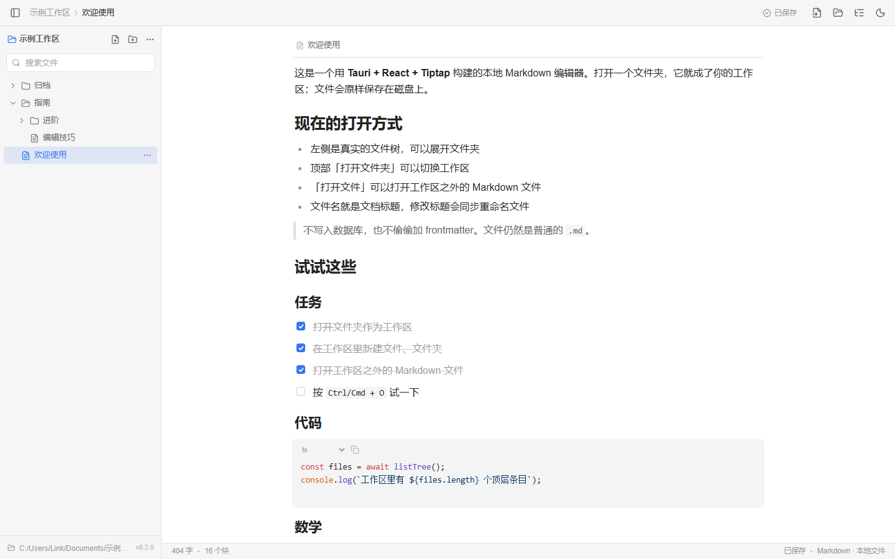
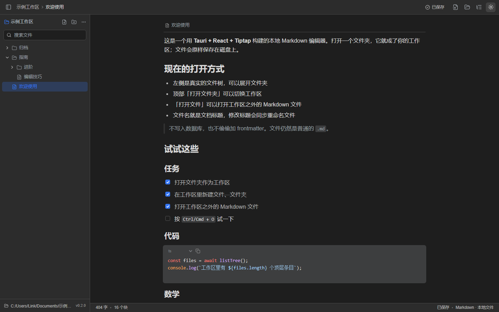
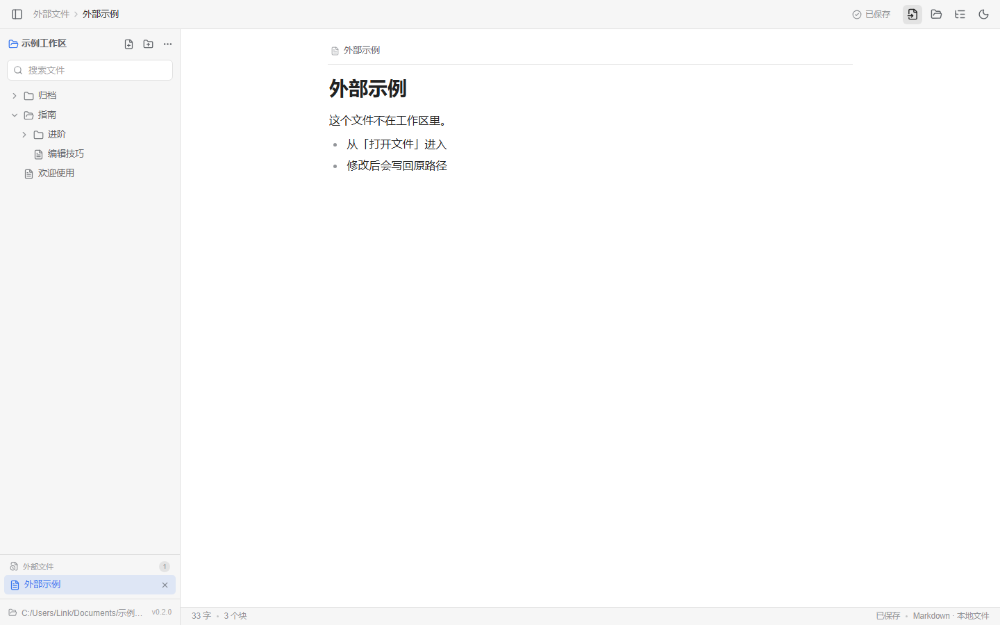
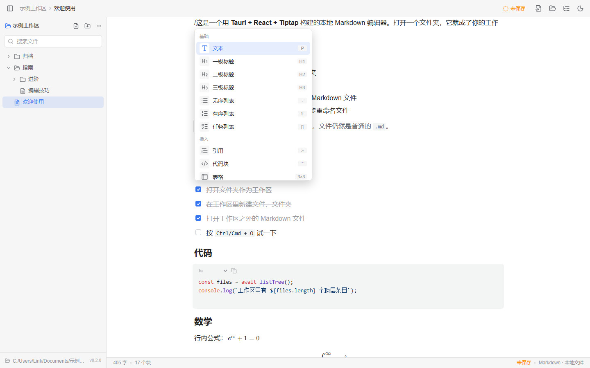
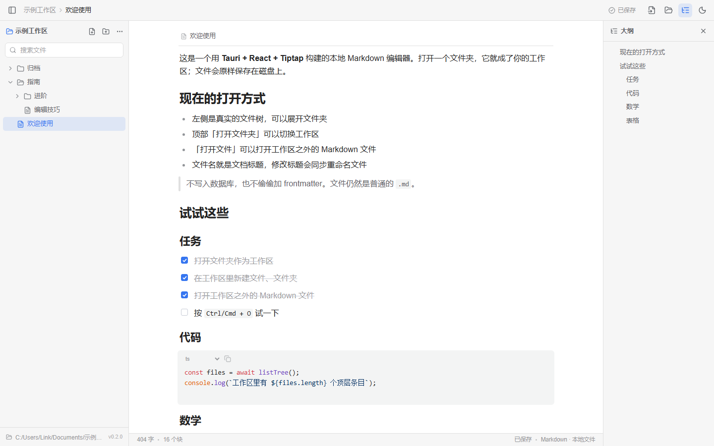

# MD编辑器 · Tauri Markdown 工作区

一个用 **Tauri 2 + React + Tiptap/ProseMirror** 构建的本地 Markdown 编辑器。文件组织方式走 Typora 路线：直接打开一个文件夹，所有内容仍是磁盘上的普通 `.md` 文件。



## 为什么不是把 Protyle 直接抽出来？

思源的编辑器模块 **Protyle**（`app/src/protyle`）包含 900 多个文件，运行时依赖 Go 内核 `/api/*`、Lute 引擎和整个应用外壳。单独抽出 Protyle，等价于同时重写一个思源内核。

所以这个项目重新实现了编辑表面：对齐思源的字号、行高、配色、块交互和 Markdown 手感，同时把文件层换成 Typora 式的文件夹工作区。

> 本项目没有复制 Protyle 源码，与思源笔记官方没有关联。

## 功能

### 工作区与文件

- **打开任意文件夹作为工作区**，下次启动自动恢复
- 左侧真实文件树，文件夹可展开 / 收起，文件名搜索，展开状态按工作区记忆
- 顶部按钮或右键文件夹**新建 Markdown 文件 / 文件夹**
- 文件名就是文档标题；文档上方的轻量文件名栏支持直接改名，并同步重命名磁盘文件
- 删除文件时移动到工作区 `.trash/`，不会直接丢失
- **打开工作区之外的 Markdown 文件**，显示在侧栏「外部文件」区，保存写回原路径
- 从外部打开的 `.md` 如果位于当前工作区内，会自动按工作区文件打开，避免同一文件被两份状态同时编辑
- 手动刷新文件树，可以在外部工具增删文件后同步

### 编辑体验

- 块式所见即所得，Markdown 即时转换，**中文语境下不需要空格**（`**加粗**`、`==高亮==` 可直接在标点后生效）
- 输入 `/` 唤起块命令菜单，支持过滤、方向键选择、回车执行
- 悬停块左侧出现「加号 + 拖拽手柄」，可拖动重排、在下方插入块
- 选中文字弹出浮动工具栏：加粗、斜体、删除线、行内代码、高亮、链接、行内公式
- 标题、引用、有序/无序/任务列表、分割线、代码块、表格
- 行内与块级 KaTeX 公式；对话框插入；双击公式可直接改 LaTeX
- 代码块语法高亮、语言切换、一键复制
- 表格支持 Tab 切换单元格、拖动列宽
- 图片支持粘贴、拖入、文件选择；自动保存到**当前文档所在目录**的 `assets/`，并以相对路径写入 Markdown
- 大纲面板
- 自动保存、`Ctrl/Cmd + S` 手动保存、切换文档 / 关闭窗口前保存
- 浅色 / 深色主题

### 文件格式

- **纯 Markdown**：不会注入 `title`、`updated` 之类的额外 frontmatter
- 文件已有的 YAML frontmatter 会原样保留，但当前不会在正文中展示或编辑
- 图片相对当前文档目录引用，例如 ``

工作区可以是任意目录：

```text
my-notes/
├─ 欢迎.md
├─ 指南/
│  └─ 编辑技巧.md
├─ assets/             # 该目录下文档的图片
└─ .trash/             # 删除的文件
```

应用设置保存在 Tauri 的应用数据目录，只记录上次打开的工作区：

- Windows：`%APPDATA%\com.link.editor\settings.json`
- macOS：`~/Library/Application Support/com.link.editor/settings.json`
- Linux：`~/.local/share/com.link.editor/settings.json`

## 截图










## 技术选型

| 层 | 技术 |
| --- | --- |
| 桌面壳 | Tauri 2 + Rust |
| UI | React 19 + TypeScript + Vite |
| 编辑器 | Tiptap 3 / ProseMirror |
| Markdown → HTML | marked + 自定义扩展（公式、高亮、任务列表） |
| HTML → Markdown | prosemirror-markdown + 自定义节点/标记序列化 |
| 公式 | KaTeX |
| 代码高亮 | lowlight |
| 图标 | lucide-react |

## 运行

需要 Node.js 20+、Rust stable，以及 [Tauri 2 的系统依赖](https://tauri.app/start/prerequisites/)（Windows 需要 WebView2，macOS 需要 Xcode Command Line Tools，Linux 需要 webkit2gtk）。

```bash
npm install

# 桌面应用（真实文件夹与文件读写）
npm run tauri dev

# 浏览器预览（内置一个演示工作区，使用 localStorage 模拟文件系统）
npm run dev

# 打包
npm run tauri build
```

## 快捷键与输入

| 操作 | 方式 |
| --- | --- |
| 打开工作区文件夹 | `Ctrl/Cmd + Shift + O` |
| 打开文件 | `Ctrl/Cmd + O` |
| 新建文件 | `Ctrl/Cmd + N` |
| 保存 | `Ctrl/Cmd + S` |
| 唤起命令 | 输入 `/` |
| 打开链接 | `Ctrl/Cmd + 点击` |
| 行内公式 | 输入 `$...$` |
| 公式块 | 输入 `$$...$$`，或 `/公式块` |
| 编辑公式 | 双击公式 |
| 标题 / 列表 / 引用 / 代码块 | 输入 `# `、`- `、`> `、三反引号 + 空格 等 |
| 加粗 / 斜体 / 删除线 / 高亮 | `**文本**`、`*文本*`、`~~文本~~`、`==文本==` |
| 表格导航 | `Tab` / `Shift + Tab` |
| 代码块缩进 / 反缩进 | `Tab` / `Shift + Tab` |
| 撤销 / 重做 | `Ctrl/Cmd + Z` / `Ctrl/Cmd + Shift + Z` |

## 项目结构

```
src/
├─ components/          # 外壳、文件树、编辑器、对话框、右键菜单、Toast
├─ editor/
│  ├─ markdown.ts       # Markdown ↔ HTML 转换与序列化
│  ├─ math.tsx          # 行内/块级公式节点与 NodeView
│  ├─ slash.tsx         # 斜杠命令 Suggestion 插件
│  └─ slashItems.tsx    # 命令定义
├─ lib/
│  ├─ storage.ts        # Tauri 命令封装 / 浏览器 mock
│  ├─ paths.ts          # 文件树路径工具
│  ├─ insertImage.ts    # 图片插入
│  └─ links.ts          # 外部链接打开
├─ styles/
└─ App.tsx
src-tauri/
├─ src/lib.rs           # 工作区、文件树、文件读写、重命名、资源命令
├─ capabilities/
└─ tauri.conf.json
```

数据流：编辑器状态变化后序列化为 Markdown，经防抖写入文件；文件名即标题，改名会调用后端重命名；图片经 `save_asset` / `import_asset` 写入当前文档目录的 `assets/`，渲染时通过 Tauri 的 asset 协议读取。

## 暂未实现

- 文件系统监听（外部修改需手动刷新）
- 文件夹重命名 / 删除、拖拽移动文件
- 多标签页 / 多窗口
- YAML frontmatter 的可视化编辑
- 全文搜索、历史版本、同步
- 块引用 / 反链、数据库 / 属性视图、日记
- 导出、打印、插件系统

## 致谢

- 编辑体验灵感来自 [SiYuan / 思源笔记](https://github.com/siyuan-note/siyuan)，其编辑器 Protyle 与 Lute 引擎出自 88250 与社区
- 配色、间距与字号参考了思源自带 daylight / midnight 主题
- 图标来自 [Lucide](https://lucide.dev)

本项目以 MIT 许可证发布，仅用于学习与个人使用。SiYuan、思源笔记等名称与商标归其各自所有者。
